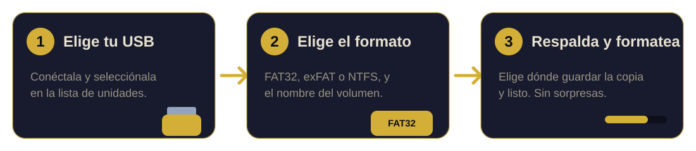

<p align="center">
  
</p>

<p align="center">
  
  
  
  
</p>

<p align="center">
  <b>Un formateador de memorias USB pequeño, rápido y sin instalación.</b><br>
  Elige la memoria, elige el formato y listo. Con copia de seguridad opcional.
</p>

  **Release Descarga:** [Release](https://github.com/xyvenqorix/GrifoFormat/releases/tag/GrifoFormat)
---

## ✨ ¿Qué es?

**GrifoFormat** es una aplicación de escritorio para Windows, escrita en C++ con la API de Windows (Win32), que formatea tus memorias USB en **FAT32**, **exFAT** o **NTFS**.

Su gran ventaja: **formatea en FAT32 memorias de 64 GB, 128 GB o más**, algo que Windows normalmente no permite (el formateador de Windows se niega a hacer FAT32 en unidades de más de 32 GB). GrifoFormat incluye su propio formateador FAT32 para lograrlo.

No necesita instalar nada, no usa librerías externas y el ejecutable resultante es un solo archivo.

## 🚀 Características

- 💾 **FAT32 en cualquier tamaño**: formateador propio, hasta 2 TB.
- 🗂️ **exFAT y NTFS** con el motor de Windows, con un plan B automático (modo forzado) si la unidad aparece "en uso".
- 🛡️ **Copia de seguridad antes de formatear**: te deja **elegir en qué carpeta** guardarla, justo al momento de respaldar.
- 🔒 **Seguridad ante todo**: solo muestra memorias USB / removibles y **nunca** el disco de Windows. Si el respaldo falla, **no se formatea nada**.
- ⚡ **Formato rápido o completo**, a tu elección.
- 🏷️ **Nombre de volumen** personalizable.
- 📊 **Barra de progreso** y mensajes de estado en vivo.
- 🔌 **Detecta al instante** cuando conectas o desconectas una memoria.
- 🔇 **Sin ventana de consola** de fondo y se relanza solo como administrador.
- 🪶 **Ligera y portable**: un solo `.exe`, sin instalador ni dependencias.

## 🧭 Cómo se usa

<p align="center">
  
</p>

1. Abre `GrifoFormat.exe` (acepta el permiso de administrador).
2. Elige tu memoria en la lista **Unidad USB**. Si no aparece, conéctala y pulsa **Actualizar**.
3. Elige el **sistema de archivos** y el **nombre del volumen**.
4. Marca **Formato rápido** (recomendado) y, si quieres, **Respaldar todo a mi PC antes de formatear**.
5. Pulsa **FORMATEAR**. Si pediste respaldo, te preguntará en qué carpeta guardarlo.

También puedes pulsar **RESPALDAR AHORA** para hacer solo la copia de seguridad, sin formatear.

> [!WARNING]
> Formatear **borra todos los datos** de la memoria y no se puede deshacer. GrifoFormat te pide confirmación (y una última advertencia si no hiciste respaldo), pero revisa bien la letra de la unidad antes de continuar.

> [!TIP]
> ¿Cuál formato elegir? **FAT32** funciona en casi todo (consolas, TV, autoradios), pero no admite archivos de más de 4 GB. **exFAT** admite archivos enormes y funciona en Windows y Mac. **NTFS** es ideal si la usarás solo con Windows.

## 💾 La copia de seguridad

- Se copian todos los archivos y carpetas de la memoria a la carpeta que elijas.
- Dentro de ella se crea una subcarpeta con la fecha y la hora, por ejemplo `GrifoFormat_USB_E_20261116_205300`, para que nunca se mezclen respaldos.
- Antes de copiar, la app revisa que haya **espacio suficiente** en el destino.
- Si eliges una carpeta **dentro de la propia memoria**, la app cancela el respaldo para no copiarla sobre sí misma.
- Si algún archivo no se puede copiar, te lo avisa y **no formatea**.

## 🛠️ Compilar

Solo necesitas un compilador de C++ para Windows. El código no requiere enlazar librerías adicionales.

| Compilador | Pasos |
|---|---|
| **Dev-C++ (MinGW)** | Crea un proyecto *Windows Application*, agrega `GrifoFormat.cpp` (y `GrifoFormat.rc` si quieres el icono) y compila. |
| **MinGW (consola)** | `windres GrifoFormat.rc -O coff -o icono.o`<br>`g++ GrifoFormat.cpp icono.o -o GrifoFormat.exe -mwindows -static` |

> [!NOTE]
> El icono de la ventana se carga del recurso `100` del `.exe`; si no existe, la app intenta cargar `grifo.ico` desde la misma carpeta. Un `GrifoFormat.rc` mínimo es: `100 ICON "grifo.ico"`.

## ⚙️ ¿Cómo funciona por dentro?

- **Detección**: lista las unidades y solo deja las removibles o de bus USB, excluyendo siempre el disco donde está Windows.
- **FAT32 propio**: bloquea y desmonta el volumen, calcula el tamaño de clúster y las tablas FAT, y escribe directamente el sector de arranque, el FSInfo, las dos tablas FAT y la etiqueta del volumen.
- **exFAT / NTFS**: usa el motor de formato de Windows (`fmifs.dll`) con reintentos; si la unidad sigue "en uso", prueba con `format.com` con desmontaje forzado.
- **Hilo aparte**: el trabajo corre en segundo plano, así la ventana nunca se congela.

## ⚠️ Limitaciones y preguntas frecuentes

<details>
<summary><b>¿Hay un límite de tamaño en FAT32?</b></summary>

FAT32 soporta unidades de hasta 2 TB, y el mínimo es de unos 35 MB. Para unidades más grandes usa exFAT o NTFS.
</details>

<details>
<summary><b>¿Por qué pide permisos de administrador?</b></summary>

Para formatear hay que escribir directamente en la unidad, y Windows solo lo permite con permisos elevados. La app se relanza sola pidiéndolos.
</details>

<details>
<summary><b>Me dice que la unidad está en uso</b></summary>

Cierra el Explorador de archivos y cualquier programa que use la memoria, desconéctala, vuelve a conectarla e inténtalo de nuevo.
</details>

<details>
<summary><b>La memoria no aparece en la lista</b></summary>

Conéctala y pulsa **Actualizar**. Solo se muestran memorias USB o unidades removibles con tamaño detectable.
</details>

<details>
<summary><b>¿Qué versión de Windows necesito?</b></summary>

Se recomienda Windows 10 u 11 (exFAT requiere Windows Vista o superior).
</details>

## 📁 Estructura del repositorio

```text
GrifoFormat/
├─ GrifoFormat.cpp      # Código fuente de la aplicación
├─ GrifoFormat.rc       # (opcional) Recurso que pone el icono al .exe
├─ grifo.ico            # Icono de la aplicación
├─ README.md
└─ assets/
   ├─ banner.svg        # Cabecera del README
   └─ como-funciona.svg # Diagrama de uso
```

## 👤 Creador

**xyvenqorix** · 🌐 [xyvenqorix.vercel.app](https://xyvenqorix.vercel.app) · 📱 +53 56639178

## 📄 Licencia

Distribuido bajo la licencia **MIT**. Agrega un archivo `LICENSE` con el texto de la licencia y tu nombre.
